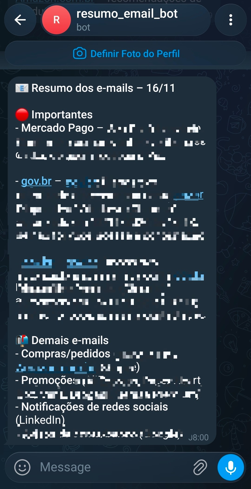
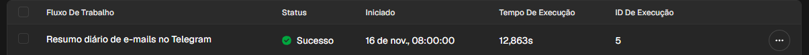

# Resumo diário de e-mails no Telegram

Automação no n8n que lê meus e-mails não lidos todo dia útil de manhã, usa IA para resumir e destacar o que é importante e manda o resultado no Telegram.

## Sobre este projeto

Este projeto é uma demonstração. Ele roda com a minha conta pessoal do Gmail, porque não uso dados de nenhuma empresa. A ideia é mostrar uma automação que, no dia a dia de trabalho, ajudaria a começar o dia já sabendo quais e-mails (e, num próximo passo, quais chamados) precisam de atenção. Numa empresa, só seria usado com a aprovação da área de segurança, lendo a caixa de e-mail corporativa.

## Problema

Todo dia, ao começar o trabalho, abro vários e-mails para descobrir o que é urgente. Muitos são promoções e notificações, e o que importa se perde no meio.

## O que o fluxo faz

De segunda a sexta, às 8h:

1. Busca no Gmail os e-mails não lidos das últimas 24 horas.
2. Monta uma lista com remetente, assunto, data e o começo do conteúdo de cada e-mail.
3. Envia a lista para um modelo de IA (GPT-5.4 mini), que separa em "Importantes" (prazos, perguntas diretas e ações necessárias) e "Demais e-mails" (agrupados por tipo).
4. Manda o resumo no Telegram.

Se não houver e-mails não lidos, chega um aviso curto.

## Demo

  

  

  

## Como foi feito

- n8n Cloud, com 5 blocos: agendamento, Gmail, preparação da lista, IA e Telegram.
- O fluxo exportado está em `resumo-emails-telegram.json`.
- O prompt pede o texto já formatado para o Telegram, com limite de tamanho.
- Só o começo de cada e-mail (1.500 caracteres) vai para a IA.

## Decisões

- **n8n Cloud em vez de Docker local:** assim a mensagem chega no celular sem eu precisar ligar o computador. A contrapartida é que o teste grátis dura 14 dias e depois é pago.
- **Telegram em vez de WhatsApp:** criar um bot leva poucos minutos. O WhatsApp exigiria a API oficial da Meta, com mais configuração.
- **E-mails sem importância agrupados por tipo:** a primeira versão tinha uma linha por e-mail e ficou longa demais.
- **Gmail pessoal:** usei só a minha conta pessoal, sem nenhum dado de empresa.

## Numa empresa

O WhatsApp faria mais sentido, porque é onde as pessoas realmente leem. A implementação teria que seguir as regras de segurança e de acesso a dados da empresa, já que os e-mails passam por um modelo de IA.

## Próximos passos

- Alerta de erro caso o fluxo falhe.
- Testar a qualidade dos resumos com mais tipos de e-mail.
- Enviar por WhatsApp.
- Incluir chamados do Jira, usando uma conta de exemplo.

## Como usar

1. No n8n, importe o arquivo `resumo-emails-telegram.json`.
2. Conecte o Gmail e o Telegram (token do bot criado no BotFather).
3. No bloco do Telegram, troque `SEU_CHAT_ID_AQUI` pelo seu ID de chat.
4. No bloco do modelo, use sua própria credencial ou os créditos do n8n.
5. Publique o fluxo.
